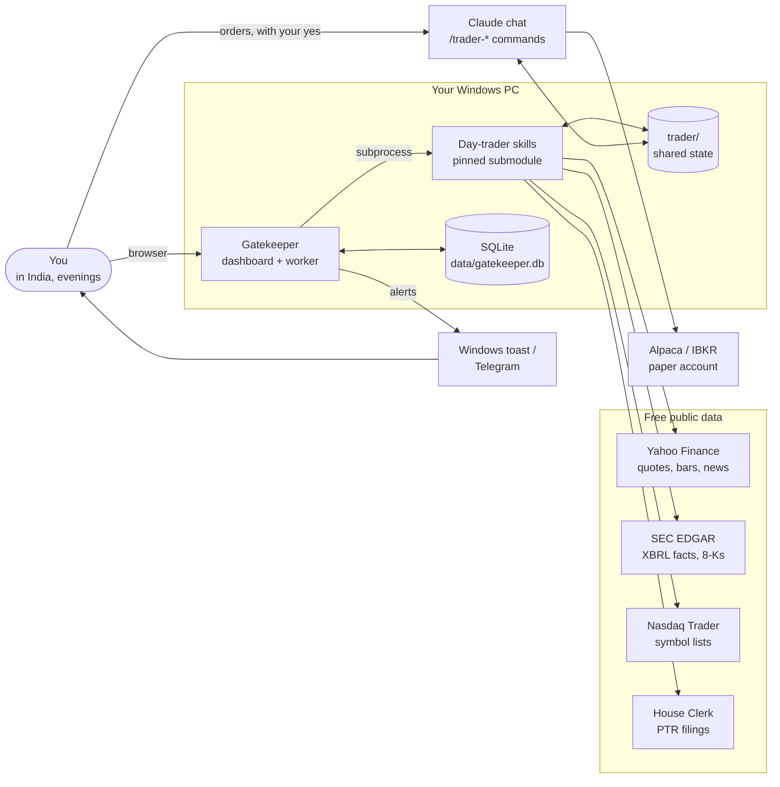
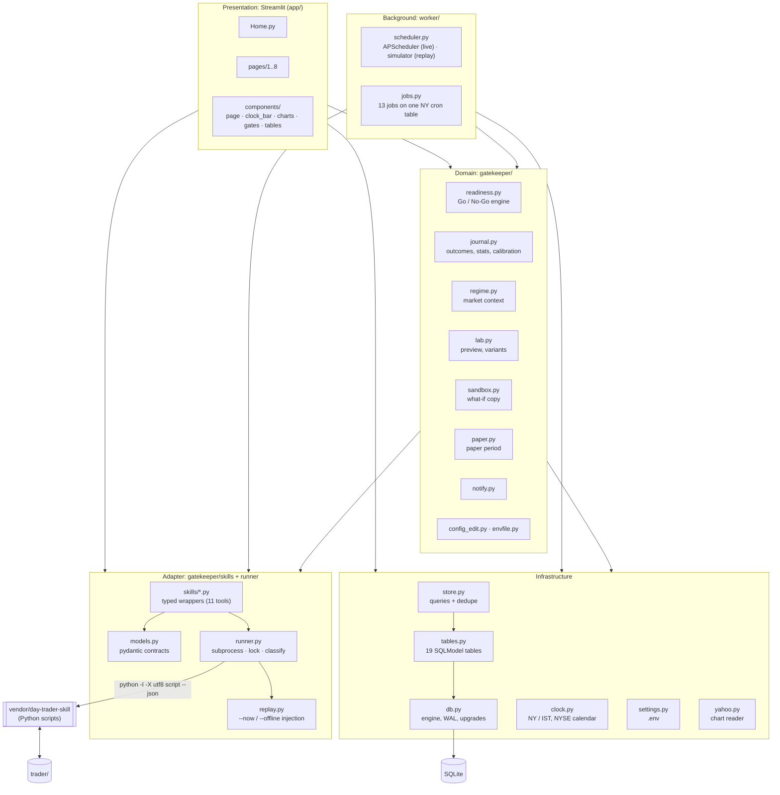
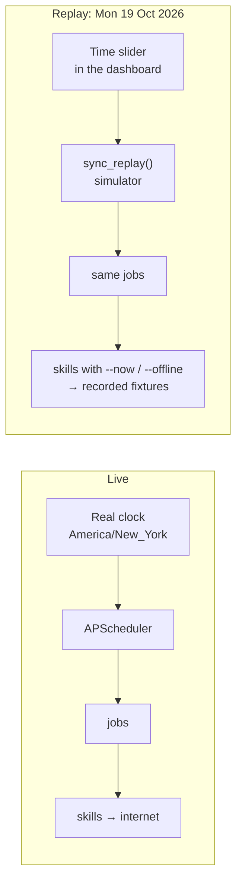
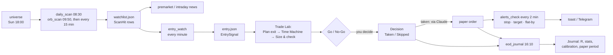
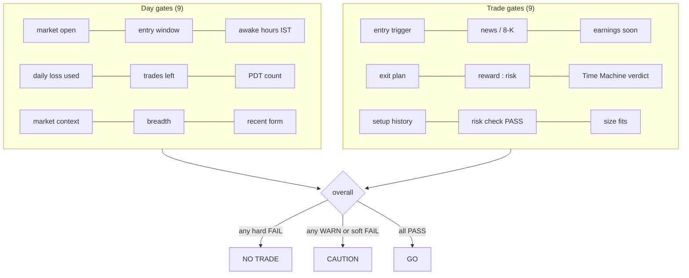
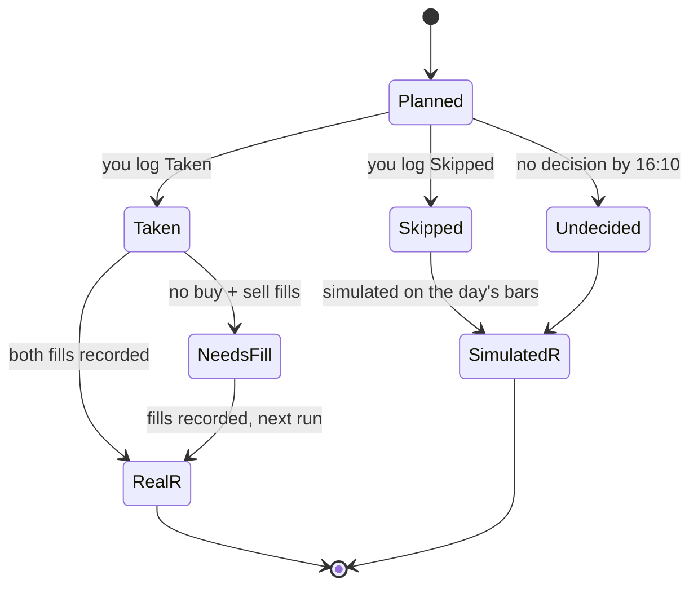
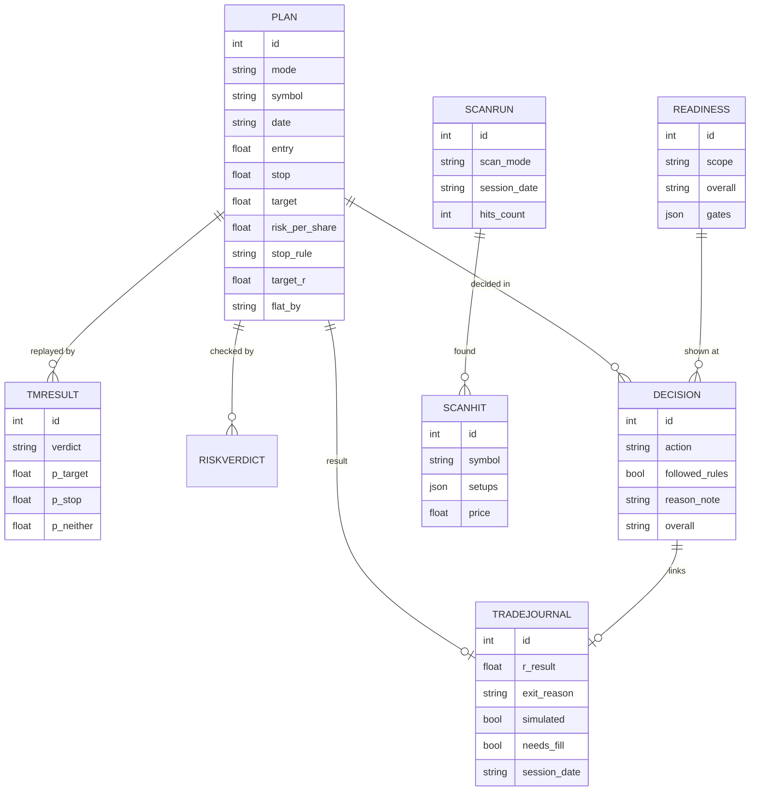

# Gatekeeper: Project Overview

> **Every trade has to earn its way in.**

This document explains Gatekeeper end to end: what it is, why it exists, how it is built
(high-level and low-level design), the design patterns it uses, every phase of the build, and
how to use it day to day.

Diagrams use [Mermaid](https://mermaid.js.org/). They render on GitHub, and in VS Code with a
Mermaid preview extension.

> Gatekeeper is decision-support tooling, **not financial advice**. It never tells you to buy or
> sell, and it never places an order by itself.

---

## Contents

1. [What Gatekeeper is](#1-what-gatekeeper-is)
2. [The problem and the benefit](#2-the-problem-and-the-benefit)
3. [What you see: the dashboard](#3-what-you-see-the-dashboard)
4. [High-level design (HLD)](#4-high-level-design-hld)
5. [Low-level design (LLD)](#5-low-level-design-lld)
6. [Design patterns and principles](#6-design-patterns-and-principles)
7. [Safety guarantees](#7-safety-guarantees)
8. [The build, phase by phase](#8-the-build-phase-by-phase)
9. [How to use it](#9-how-to-use-it)
10. [Testing, validation and CI](#10-testing-validation-and-ci)
11. [Limits and honest notes](#11-limits-and-honest-notes)
12. [Glossary](#12-glossary)
13. [Where to read more](#13-where-to-read-more)

---

## 1. What Gatekeeper is

Gatekeeper is a Python dashboard and a background worker. Together they run the eleven
[day-trader skills](https://github.com/Jakeschincariol/day-trader-skill) on a schedule, store
every result, and answer one question for the day and for each trade idea:

> **Do my rules and the honest odds say GO, CAUTION or NO TRADE?**

The skills are command-line tools written for Claude chat. They scan charts, read news and SEC
filings, time an entry, plan the stop and target, replay the trade 10,000 times, size the
position, and check it against your risk limits. Run by hand in a chat, they answer one question
at a time.

Gatekeeper turns them into a system:

- **It watches.** A worker runs the right skill at the right New York minute: scans before the
  open, the opening-range scan at 09:50, entry checks every minute, news every 15 minutes,
  alerts every 2 minutes, and the journal after the close.
- **It shows.** A Streamlit dashboard puts the market, your watchlist, the trade plan, the odds,
  the size, the risk check and your record on one screen, in New York and India (IST) time.
- **It judges.** A Go / No-Go engine combines 18 checks (9 for the day, 9 for the trade) into
  one verdict, and shows every reason.
- **It remembers.** Every plan gets a **Taken** or **Skipped** decision. After the close, the
  result is measured in R, real or simulated, so you learn whether following the process helps.

It is built for someone in **India trading US stocks in the evening**: the session runs
19:00–01:30 IST (20:00–02:30 IST in US winter time). The default rules keep entries inside
the hours you are awake.

### What it is not

- **Not a trading bot.** Nothing places, cancels or replaces an order. Orders go through Claude
  chat (`/trader-broker`) with your typed yes. The optional Phase 8 would add paper-only orders,
  still behind your confirmation.
- **Not a signal service.** It shows the rules you set and the measured odds. The decision is
  yours, and it is logged.
- **Not live by default.** The skills' `paper` flag is read-only in Gatekeeper; nothing ever
  switches it.

---

## 2. The problem and the benefit

### The problem

Most day-trading losses come from process, not from a missing indicator:

| Failure | What it looks like |
| --- | --- |
| Trading outside your plan | An entry at 23:45 IST because the chart "looked good" |
| No stop, or a moved stop | A small loss becomes a big one |
| Oversizing | One trade risks a week's budget |
| Ignoring context | A breakout bought into an earnings report or a falling market |
| Coin-flip trades | A setup whose replays hit the target no more often than the stop |
| No record | You can't tell whether your process works, so you can't improve it |

### What Gatekeeper gives you

| Benefit | How |
| --- | --- |
| **Discipline by default** | Hard gates (entry window, daily loss, trades left, plan, reward:risk, risk check, size) make a rule-breaking trade show **NO TRADE**, with the reason |
| **Honest odds before risking a dollar** | The Time Machine's 10,000 replays plus every past firing of the setup; a "coin flip" verdict is flagged |
| **Right-sized positions** | Whole shares that fit four limits (max loss, position cap, max order, cash after buffer), and the page says which limit decided |
| **Context at a glance** | Index tiles, VIX, breadth from the opening-range scan, news tagged by type, SEC 8-Ks, earnings dates |
| **Time-zone safety** | Every time in New York and IST, a flat-by countdown, and alerts on Windows toast or Telegram |
| **A learning loop** | Every plan's result in R, including the ones you skipped; calibration of the verdicts; expectancy, drawdown, adherence |
| **An evidence-based go-live decision** | The paper-trading period: 40+ decisions, positive expectancy and 95 %+ rule adherence before any real money |
| **Reproducibility** | A recorded trading day (Mon 19 Oct 2026) replays the whole system offline, with known numbers |

---

## 3. What you see: the dashboard

| Page | What it shows |
| --- | --- |
| **Home** | The clock bar (NY and IST, session phase), index tiles, market context, breadth, the **day-level Go / No-Go**, budget left today, what changed, worker health |
| **1 Scanner** | Daily setups (20-day breakouts, bull flags, oversold bounces) and the opening-range breakout scan; filters, pin to the watchlist, open in the Trade Lab |
| **2 Watchlist & News** | Pinned tickers with their moves and entry status, the next earnings date, and a tagged news stream (earnings, analyst, deal, halt, regulatory, macro) |
| **3 Trade Lab** | The candle chart with the opening range and trigger; **Check entry → Plan exit → Time Machine → Size & check**; the **trade-level Go / No-Go**; plan variants compared; Add plan alerts; log **Taken / Skipped** |
| **4 Risk & Size** | Your limits, the four sizing limits as a chart, check.py's verdict, today's ledger, and **What if** (another price or share count, run on a throwaway copy) |
| **5 Positions & Alerts** | Open positions in R, the flat-by countdown, the closing ticket, recording fills, alert rules and history |
| **6 Journal** | The decision log, results in R (taken vs. all plans), cumulative R, histogram, calibration, breakdowns, the paper → live readiness card, the paper-period checklist and weekly table, CSV export |
| **7 Research** | Earnings from SEC EDGAR (revenue, EPS, margins, year on year), and Congress trades (STOCK Act filings) flagged against your tickers |
| **8 Settings** | Trading rules (`trader/config.json`, with diff and backup; `paper` read-only), dashboard settings (`.env`), diagnostics and the contract self-test |

---

## 4. High-level design (HLD)

### 4.1 System context



Gatekeeper and Claude chat share the same `trader/` folder: the same config, plan, orders and
ledger. A plan made in the dashboard can be sent from Claude, and a fill recorded in Claude shows
up in the dashboard.

### 4.2 Architecture (containers and layers)



**Layering rule.** Only `runner.py` starts a skill process. Pages and jobs call typed wrappers
(`entry.check()`, `exit.plan()`, `timemachine.run_plan()` …) and get pydantic models back, never
raw JSON. Domain modules are pure where they can be (`readiness`, `journal`, `regime`, `paper`
work on inputs passed in), so they are tested without a network or a subprocess.

### 4.3 Runtime processes

| Process | Started by | Does |
| --- | --- | --- |
| `uv run python -m worker` | you, `scripts/dev.ps1`, or the Task Scheduler task (`scripts/worker_task.ps1`) | Runs the 13 jobs live on the New York schedule; writes heartbeats, results and notifications |
| `uv run streamlit run app/Home.py` | you or `scripts/dev.ps1` | The dashboard at http://127.0.0.1:8501; reads the database, runs skills on demand (Trade Lab, Risk) |
| Skill subprocesses | the runner | One short-lived Python process per call, isolated (`-I`), UTF-8, with a timeout |

The worker and the dashboard never talk to each other directly. They share the SQLite database
(WAL mode, so readers don't block the writer) and the `trader/` folder (guarded by a file lock).

### 4.4 Live mode and replay mode



- **One schedule, two drivers.** The same cron table feeds APScheduler (live) and a simulator that
  fires every due job between two times (replay). The jobs don't know which mode they run in.
- **Replay injection.** In replay the runner adds `--now <time>` and `--offline` /
  fixture paths to each skill call, and works in its own `replay/workspace/trader/`. Your real
  `trader/` is never touched.
- **The slider is the worker.** Moving the slider forward simulates only the jobs not yet run.
  Moving it back rebuilds the day from 07:00 in a fresh workspace.

### 4.5 Data flow through a trading evening



---

## 5. Low-level design (LLD)

### 5.1 Repository layout

```text
Gatekeeper/
├── app/                      Streamlit UI
│   ├── Home.py               day-level overview
│   ├── state.py              mode, replay time, "now"
│   ├── components/           page shell, clock bar, charts, gate panels, tables
│   └── pages/                1_Scanner … 8_Settings
├── gatekeeper/               the library
│   ├── runner.py             the only place a skill process starts
│   ├── replay.py             replay workspace and --now / --offline injection
│   ├── skills/               typed wrappers + models.py (pydantic contracts)
│   ├── readiness.py          Go / No-Go: 18 gates, overall rule, context builders
│   ├── journal.py            outcomes, R, stats, calibration, breakdowns, readiness card
│   ├── regime.py             market context from index and VIX bars + breadth
│   ├── lab.py                stop / target preview, plan variants
│   ├── sandbox.py            what-if on a throwaway copy of trader/
│   ├── paper.py              paper period: evening rules, checklist, weekly review
│   ├── notify.py             Windows toast / Telegram
│   ├── config_edit.py        trader/config.json: validate, diff, backup, save
│   ├── envfile.py            .env: edit allowed keys only
│   ├── clock.py              NY / IST, session phase, NYSE calendar
│   ├── yahoo.py              chart reader
│   ├── db.py, tables.py, store.py   SQLite engine, 19 tables, queries
│   └── settings.py           pydantic-settings from .env
├── worker/                   jobs.py, scheduler.py, __main__.py (CLI)
├── scripts/                  validate.py, paper.py, dev.ps1, worker_task.ps1, snapshot_contracts.py
├── tests/                    388 tests + tests/contracts/ (18 saved skill outputs)
├── vendor/day-trader-skill/  the skills, pinned as a git submodule
├── trader/                   shared state with Claude chat (gitignored)
└── data/                     database, worker log, backups (gitignored)
```

### 5.2 The skill runner (adapter boundary)

```mermaid
sequenceDiagram
    participant C as Caller (page / job)
    participant W as Wrapper (e.g. entry.check)
    participant R as SkillRunner
    participant L as FileLock trader/.gatekeeper.lock
    participant P as Skill process
    participant DB as SkillRun table

    C->>W: check("TSLA", write=True)
    W->>R: run("entry", ["TSLA","--json",...], writes_state=True)
    R->>R: replay? add --now / --offline, use replay workspace
    R->>L: acquire (only when the call writes trader/)
    R->>P: python -I -X utf8 entry.py TSLA --json (timeout)
    P-->>R: exit code, stdout (JSON), stderr
    R->>L: release
    R->>R: classify: JSON present → ok / empty / blocked / partial; no JSON → error
    R->>DB: record tool, args, status, duration, message
    R-->>W: RunResult
    W-->>C: (EntryStatus model | None, RunResult)
```

- **Classification.** Many skills exit non-zero for a valid "no" (for example, risk BLOCK).
  The runner trusts the JSON: if a document came back, it is an answer (`ok`, `empty`, `blocked`,
  `partial`). Only a missing document is an `error`.
- **Isolation.** `-I` ignores the user's environment and site packages; `-X utf8` makes Windows
  output safe.
- **Contracts.** `models.py` was written from real skill output. Eighteen outputs are saved
  in `tests/contracts/`. The contract tests check that fresh runs still parse and keep the same
  structure, so a skills upgrade that changes the output fails loudly.

### 5.3 The worker

| Job | When (New York) | What it does |
| --- | --- | --- |
| `clock` | every minute | NYSE status, session phase, heartbeat |
| `universe` | Sun 18:00 | US common stocks, ordinary shares and ADRs from Nasdaq Trader |
| `analyst_watchlist` | Mon–Fri 07:00 | Earnings snapshots for watched tickers (SEC) |
| `daily_scan` | Mon–Fri 08:30 | Daily-close setups → watchlist |
| `premarket_news` | Mon–Fri 08:45 | Headlines, 8-Ks, moves since yesterday |
| `orb_scan` | 09:50, then every 15 min to 15:45 | Opening-range breakouts on 5-minute bars |
| `regime` | every 5 min, 09:00–15:55 | Market context (indexes, VIX, breadth) |
| `intraday_news` | every 15 min | New headlines only, tagged |
| `entry_watch` | every minute | Entry status for pinned tickers (waiting / triggered / expired) |
| `quotes` | every 5 min | Fresh prices for sizing and risk |
| `alerts_check` | every 2 min | Price / stop / target / flat-by alerts → notifications (live only) |
| `pelosi` | hourly 08:00–20:00 | New Congress trade filings |
| `eod_journal` | Mon–Fri 16:10 | Each plan's result in R |

Each job takes a `JobContext` (engine, mode, clock, runner factory, notifier). It raises `Skip`
when it doesn't apply (for example "not now (entry_window)"), and records a `JobHeartbeat`
(last run, status, detail, errors). A failing job is logged and counted. It never stops the
scheduler.

### 5.4 The Go / No-Go engine



- Each gate is a **pure function** `(context, settings) -> Gate(name, level, status, reason, source)`.
  `level` is `hard` or `soft`; `status` is `PASS`, `WARN` or `FAIL`.
- Contexts (`DayContext`, `TradeContext`) are built once from the database and `trader/`, so the
  gates do no I/O.
- Thresholds live in settings (`GATE_*` in `.env`), for example `GATE_BREADTH_WARN_PCT=10` or
  `GATE_TM_NEITHER_WARN_PCT=40`.
- Results are stored in `Readiness` (an unchanged result is stored at most every N minutes), and
  each `Decision` records the verdict shown when you decided.

### 5.5 The journal

**Outcome of a plan** (`journal.simulate_outcome`), on the day's 5-minute bars from the entry bar:

1. Ignore bars before the entry and ticks off the 5-minute grid.
2. For each bar: if `low ≤ stop` → **−1R** (stop is checked first; a bar touching both counts as
   the stop). Otherwise, if `high ≥ target` → **+target R**.
3. Otherwise, exit at the close of the last bar before `flat_by` → **flat**. If the bars end
   earlier, the reason is **data_end**, not flat.

**Real R** from fills: `(exit − entry_fill) / risk_per_share`; an exit within 1 cent of the
stop or target is labelled as such.

**The 16:10 job**, for every plan today (the latest per symbol):



There is one `TradeJournal` row per plan (an upsert), so re-running the job is safe.

**Statistics:** n, win rate, average win and loss, expectancy, total R, profit factor, maximum
drawdown in R, longest losing streak, adherence. **Calibration:** realised win rate and average R
per Time Machine verdict. **Readiness card:** 40+ real taken trades, expectancy > 0R, rules
followed in 95 %+ of decisions.

### 5.6 Data model (main tables)



The other tables: `SkillRun` (every skill call), `JobHeartbeat`, `NewsItem`, `PriceMove`,
`EarningsSnapshot`, `RegimeSnapshot`, `EntrySignal`, `RiskVerdict`, `AlertFired`,
`PelosiFiling`, `PinnedTicker`, `ReplayState`. Every row carries `mode` (`live` / `replay`), so
the two never mix. Datetimes are stored as timezone-aware UTC. `init_db` adds new columns to an
older database in place.

### 5.7 Planning a trade (Trade Lab sequence)

```mermaid
sequenceDiagram
    actor You
    participant TL as Trade Lab
    participant SK as Skills (via runner)
    participant DB as Database
    participant GE as Go / No-Go

    You->>TL: Check entry (TSLA)
    TL->>SK: entry.check → TRIGGERED 10:15 at 364.18
    You->>TL: Plan exit (or-mid stop, 1R)
    TL->>SK: exit.plan → stop 358.32, target 370.04, risk 5.86
    TL->>DB: save Plan
    You->>TL: Run the Time Machine
    TL->>SK: timemachine.run_plan → 29.4 % target / 25.5 % stop / 45.1 % neither
    TL->>DB: save TmResult
    You->>TL: Size & check
    TL->>SK: budget.size → 8 shares ($46.88 at the stop); risk.check → PASS
    TL->>GE: evaluate_trade(context)
    GE-->>TL: CAUTION (coin flip; earnings in the news)
    You->>TL: Log Skipped (or Taken → ticket for /trader-broker)
    TL->>DB: save Decision
```

These are the replay day's golden numbers. Nine shares would be **BLOCK** ($52.74 > $50 max loss).

---

## 6. Design patterns and principles

| Pattern | Where | Why |
| --- | --- | --- |
| **Adapter / anti-corruption layer** | `runner.py` + `skills/*.py` + `models.py` | The skills are CLIs with their own JSON; the rest of the code sees typed pydantic models only |
| **Facade** | One wrapper per tool (`entry.check`, `budget.size` …) | One call hides arguments, flags, locking and parsing |
| **Contract / snapshot testing** | `tests/contracts/`, `test_models_contract.py` | Detects skill output changes before they break pages |
| **Golden master** | `test_replay_e2e.py` | The recorded day must reproduce 41 · 364.18 · 358.32 / 370.04 · 29.4 / 25.5 / 45.1 · 8 shares · PASS |
| **Rule list / Strategy** | `DAY_GATES`, `TRADE_GATES` lists of gate functions | Add or change a check without touching the engine; each is tested at its edges |
| **Pure core, imperative shell** | `readiness`, `journal`, `regime`, `paper` take plain inputs | Deterministic tests; I/O stays in context builders, jobs and pages |
| **Context object / dependency injection** | `JobContext`, `SkillRunner.from_settings`, `notifier`, `day_lookup` | The same job runs live, in replay and in tests with fakes |
| **Clock abstraction** | `clock.py`, `SimClock`, `--now` injection | Time is an input, so a whole day can be replayed |
| **Scheduler with one cron table** | `SCHEDULE` → APScheduler or `simulate()` | Live and replay can't drift apart |
| **Repository-style store** | `store.py` | Queries, dedupe rules ("skip an unchanged result") and upserts in one place |
| **Unit of work** | `with session(engine) as s:` | A commit per logical step |
| **Idempotent upsert** | `save_journal`, `save_plan` | Jobs can re-run safely |
| **Mutual exclusion** | `FileLock` on `trader/` | The worker, the dashboard and Claude chat never write the shared state at once |
| **Sandbox / copy-on-write** | `sandbox.what_if` | Try another price or size on a throwaway copy; `trader/` is byte-for-byte unchanged |
| **Fail-safe defaults** | `paper` read-only, notifications never raise, unknown → WARN | Errors make the system more careful, not less |
| **Backup before write** | `config_edit.save`, `envfile.update` | Every edit is reversible |
| **Allow-list** | `envfile.EDITABLE` | The dashboard can't write keys or tokens |
| **Observer-style notifications** | `alerts_check` → `notify()` | Alerts fan out to the channel in `.env` |
| **Twelve-factor config** | `settings.py` (pydantic-settings) | Everything comes from `.env` / the environment, with validation |

**Principles kept throughout:** no buy / sell advice wording (enforced by `test_wording.py`); NY
time for computing and IST for showing; every check explains itself; nothing hidden behind a
single score.

---

## 7. Safety guarantees

| Guarantee | How it is enforced |
| --- | --- |
| No order is placed, cancelled or replaced by Gatekeeper (through Phase 7 and P) | No broker client is installed; tickets are text for Claude chat |
| `paper` is never changed | The Settings toggle is disabled; `config_edit.save` raises `PaperChangeRefused` either way; new files start with `paper: true`; tested |
| Keys and tokens never pass through the UI | `.env` allow-list; secrets are never logged |
| Your real `trader/` is untouched by replay and what-if | A separate replay workspace; the sandbox copy; hash tests |
| Shared state isn't corrupted | `FileLock` around every writing skill call |
| A failure doesn't stop the evening | Jobs catch, record and continue; notifications return False instead of raising |
| No advice | Wording test over the app and the engine |

---

## 8. The build, phase by phase

| Phase | Name | Status | What it delivered |
| --- | --- | --- | --- |
| 0 | Foundation | ✅ | uv project, skills pinned as a submodule, settings, NY / IST clock with session phase, Home with the clock bar, CI on Windows and Ubuntu |
| 1 | Skill adapter & contracts | ✅ | The runner (classification, lock, isolation, timeout, replay injection), 30+ typed models, wrappers for all 11 tools, 18 contract snapshots, NYSE calendar, golden-number tests, `validate.py` |
| 2 | Storage & background worker | ✅ | SQLite (WAL), store with dedupe rules, 13 jobs on one NY schedule, live APScheduler and the replay simulator, worker CLI (`--list`, `--once`, `--run-for`, `--replay`, pins) |
| 3 | Market Overview, Scanner, News | ✅ | Chart reader, market context, Home tiles and breadth, Scanner, Watchlist & News, the replay slider that drives the simulator |
| 4 | Trade Lab | ✅ | Candle chart with levels, entry → exit → Time Machine flow, odds charts, plan preview and variants |
| 5 | Go / No-Go engine | ✅ | 18 gates, the GO / CAUTION / NO TRADE rule, decision log, panels on Home and the Trade Lab, the ticket for Claude, database upgrades in place, the no-advice wording test |
| 6 | Risk, Size, Positions, Alerts | ✅ | Risk & Size page with the what-if sandbox, Positions & Alerts (R, countdown, closing ticket, fills), Windows toast / Telegram notifications |
| 7 | Journal & Research | ✅ | Outcomes and stats, the 16:10 journal job, Journal, Research (EDGAR, Congress) and Settings pages, config and `.env` editing with backups |
| P | Paper-trading period | 🟨 tools built | Evening rules, checklist, weekly review, Journal section, weekday worker task. **The 4–8 weeks of use are yours** |
| 8 | Alpaca paper execution (optional) | ⬜ | Paper-only orders from the dashboard (`paper=True` hard-coded, typed confirmation, never from a job); only if Phase P shows an edge |
| 9 | Hardening & operations | ⬜ | Retries and stale-data banners, worker restart, keep-awake, nightly backups, log rotation, skills upgrade procedure, README runbook |

Every finished phase was built on its own branch, tested, checked with
`scripts/validate.py --phase N`, passed CI on Windows and Ubuntu, and was merged into `main`.
[IMPLEMENTATION_GUIDE.md](IMPLEMENTATION_GUIDE.md) has every task, decision, issue and log line.

---

## 9. How to use it

### 9.1 Install (once)

```powershell
git clone --recurse-submodules https://github.com/Rishav123raj/Gatekeeper.git
cd Gatekeeper
uv sync --extra notify            # --extra notify adds Windows toasts
copy .env.example .env            # then set SEC_USER_AGENT=Your Name you@example.com, NOTIFY=toast
uv run python scripts/paper.py rules      # trader/config.json for the evening window (on paper)
uv run python scripts/validate.py --live  # every phase's checks, PASS / FAIL
```

### 9.2 Try it offline first (replay)

```powershell
$env:GATEKEEPER_MODE = "replay"; uv run streamlit run app/Home.py
```

Slide the clock to 10:15 on Mon 19 Oct 2026. You should see:

- the Scanner shows 41 opening-range breakouts with TSLA among them;
- the Trade Lab triggers at 364.18, plans 358.32 / 370.04, and replays 29.4 / 25.5 / 45.1;
- the trade sizes at 8 shares and the Go / No-Go says CAUTION.

Log a decision, slide to 16:10, and the Journal shows the result.

**Or share it:** a hosted copy with `PUBLIC_DEMO=true` (for example on Streamlit Community Cloud)
gives every visitor their own private replay of that day, with no live data and nothing shared.
The steps are in [COMMANDS.md](COMMANDS.md#host-a-public-demo-anyone-with-the-link).

### 9.3 A live evening (IST)

| IST (summer / winter) | NY | What to do |
| --- | --- | --- |
| 18:00 | — | The worker starts (Task Scheduler) or run `scripts\dev.ps1`; open http://127.0.0.1:8501 |
| 18:30 / 19:30 | 09:00 | Home: the day-level Go / No-Go, market context, overnight news |
| 19:00 / 20:00 | 09:30 | The market opens; the opening range forms |
| 19:20 / 20:20 | 09:50 | ORB scan: pin candidates, watch entry status |
| 19:15–20:30 / 20:15–21:30 | 09:45–11:00 | **Entry window.** On a trigger: Trade Lab → plan → Time Machine → Size & check → read the verdict → **log Taken or Skipped** |
| — | — | Taken: send the ticket with `/trader-broker` in Claude (paper), add plan alerts, record fills |
| 21:30 / 22:30 | 12:00 | **Flat by.** The alert rings; close any position |
| 01:40 / 02:40 | 16:10 | The worker writes the journal (it runs on its own) |
| Weekend | — | `uv run python scripts/paper.py review --update-guide`; read the Journal |

### 9.4 The paper-trading period (before any real money)

1. One setup only, for example the 15-minute opening-range breakout, `or-mid` stop, 2R target.
2. Every plan gets Taken or Skipped, with "followed rules" ticked honestly.
3. `uv run python scripts/paper.py status` shows the checklist; the Journal shows it too.
4. After **40+ decisions**: if expectancy is above 0R, adherence is 95 %+, and "Leans target"
   verdicts beat "Coin flip" ones, consider Phase 8. If not, change the setup and run the period
   again.

### 9.5 Everyday commands

| Task | Command |
| --- | --- |
| Start worker + dashboard | `powershell -ExecutionPolicy Bypass -File scripts\dev.ps1` |
| Worker only / list its jobs | `uv run python -m worker` / `uv run python -m worker --list` |
| Run one job now | `uv run python -m worker --once orb_scan` |
| Pin tickers for the entry watch | `uv run python -m worker --pin TSLA,NVDA` |
| Weekday worker task | `powershell -ExecutionPolicy Bypass -File scripts\worker_task.ps1 -Install` |
| Paper-period checklist / weekly review | `uv run python scripts/paper.py status` / `review --update-guide` |
| Validate a phase | `uv run python scripts/validate.py --phase 7 --live` |
| All tests / lint | `uv run pytest` / `uv run ruff check .` |

[COMMANDS.md](COMMANDS.md) has the full list.

---

## 10. Testing, validation and CI

| Layer | Examples | Count |
| --- | --- | --- |
| Unit (pure logic) | every gate at its PASS / WARN / FAIL edges; journal math worked out by hand; IST across the November change; config validation | most of the 388 |
| Contract | 18 saved skill outputs parse; fresh runs keep the same structure | 39 |
| Golden end-to-end | the recorded day reproduces every documented number | 18 |
| Worker | a replay day 07:00–16:10, guards, CLI, alert → notification once | ~30 |
| UI (Streamlit AppTest) | every page renders in replay; Trade Lab flow; What-if BLOCK at 9 shares; Settings backup; Journal row | ~40 |
| Guard rails | no buy / sell advice wording; `trader/` unchanged by what-if (hash) | — |
| Upstream | the skills' own test suite | 315 |

- **`scripts/validate.py --phase N [--live]`** prints PASS / FAIL per check for a phase.
  `--live` adds internet checks (a real NYSE clock, SPY entry, index tiles, EDGAR, a test
  notification).
- **CI** (GitHub Actions, windows-latest and ubuntu-latest): install, ruff, the skills' 315
  tests, and Gatekeeper's tests with a 600 s per-test timeout. A failure is posted as a public
  annotation.

---

## 11. Limits and honest notes

- **Data is free and delayed.** Yahoo quotes and bars are not a broker feed; a fast market can
  move past a level before the dashboard sees it. Use limit orders and your broker's own stops.
- **Long side only.** The skills plan long breakouts; shorts are refused by the risk check.
- **The Time Machine is a model.** It resamples the stock's own last 60 days. A "leans target"
  verdict is better odds, not a promise.
- **Simulated R for skipped plans is approximate.** It uses 5-minute bars, checks the stop first,
  and ignores slippage, so it is a fair comparison, not exact.
- **Replay is one recorded day.** Its news quote is a 10:52 snapshot and its bars end at 10:45,
  so late-day results there say `data_end`.
- **Windows-first.** The worker task, toasts and scripts target Windows 10/11; the library and
  tests also run on Linux (CI).
- **Still to verify live:** a full weekday session of the worker and dashboard, a live SPY entry
  check, and a toast on your screen (Issues 2, 4 and 7 in the tracker).

---

## 12. Glossary

| Term | Meaning |
| --- | --- |
| **R** | The plan's risk per share. +1R = gained what you risked; −1R = lost it |
| **Expectancy** | Average R per trade. Above 0 means the process makes money on average |
| **ORB** | Opening-range breakout: the first completed bar closing above the first 15 minutes' high |
| **or-mid stop** | A stop at the midpoint of the opening range |
| **Flat by** | The time every position must be closed (12:00 NY in the evening setup) |
| **Time Machine** | 10,000 simulated replays of the rest of the day, plus every past firing of the setup |
| **Coin flip** | A verdict where target-first and stop-first are about equally likely |
| **Hard / soft gate** | A hard FAIL means NO TRADE; a soft FAIL or any WARN means CAUTION |
| **Adherence** | The share of decisions where you followed your rules |
| **PDT** | The US pattern-day-trader rule (4+ day trades in 5 business days under $25k) |
| **Paper account** | A broker account with simulated money |

---

## 13. Where to read more

| Document | For |
| --- | --- |
| [README.md](README.md) | The short introduction and quick start |
| [DASHBOARD_PROJECT_PLAN.md](DASHBOARD_PROJECT_PLAN.md) | The original plan: goals, screens, gates, milestones |
| [IMPLEMENTATION_GUIDE.md](IMPLEMENTATION_GUIDE.md) | The build tracker: every task, decision, issue and progress line |
| [COMMANDS.md](COMMANDS.md) | Every command, with what it proves |
| [DAY_TRADER_GUIDE.md](DAY_TRADER_GUIDE.md) | The skills themselves, used from Claude chat |
